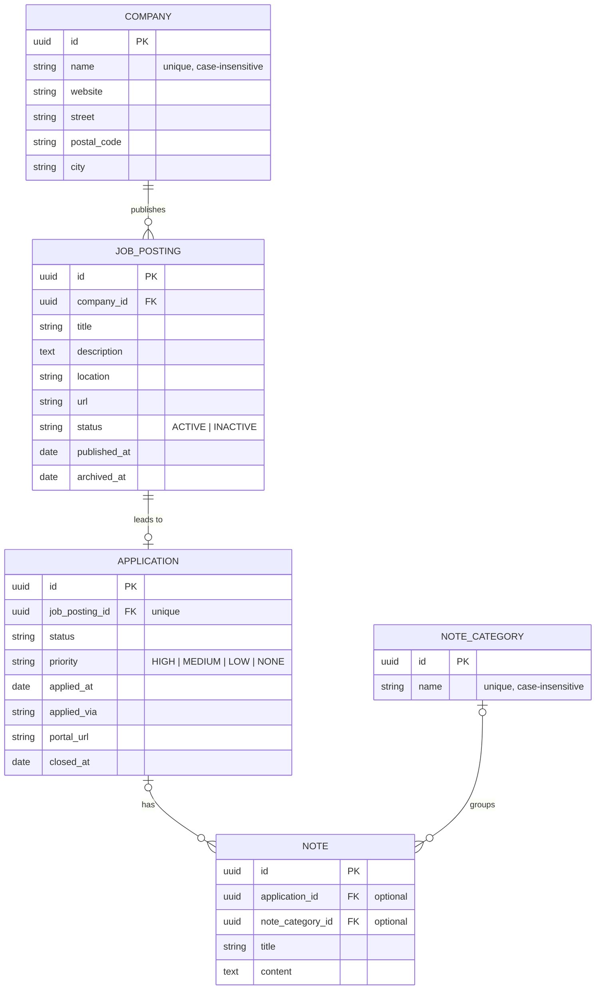

<p align="center">
  <picture>
    <source media="(prefers-color-scheme: dark)" srcset="./docs/logo-mark-dark.svg">
    
  </picture>
</p>

<h1 align="center">JobMappe — Backend</h1>

<p align="center">
  <strong>REST API of JobMappe, a job-application tracker for the German job market</strong><br>
  Job postings, companies, applications and notes, with validation, pagination, filtering and consistent error responses.<br><br>
  <a href="https://github.com/hakikafetzi/jobmappe"><strong>Project overview</strong></a> ·
  <a href="https://github.com/hakikafetzi/jobmappe-frontend"><strong>Frontend (React)</strong></a> ·
  <a href="#getting-started"><strong>Getting started</strong></a>
</p>

<p align="center">
  <a href="https://github.com/hakikafetzi/jobmappe-backend/actions/workflows/ci.yaml"></a>
  
  
  
  
</p>

---

## About

This repository contains the backend of [JobMappe](https://github.com/hakikafetzi/jobmappe): a Spring Boot REST API for job postings, the companies behind them, applications with their status and priority, and notes.

I wrote the backend myself as a learning project, to build a solid foundation in Spring Boot and to use the app in my own job search. The focus is a clean, consistent API and a codebase without over-engineering, rather than as many features as possible. The [frontend](https://github.com/hakikafetzi/jobmappe-frontend) was built with an AI coding agent; its README explains how.

> To run the complete application (database, backend and frontend) with Docker Compose, see the [project overview](https://github.com/hakikafetzi/jobmappe#self-hosting). This README is about the backend itself.

## Table of contents

- [Tech stack](#tech-stack)
- [Architecture](#architecture)
- [Data model](#data-model)
- [API](#api)
- [Getting started](#getting-started)
- [Configuration](#configuration)
- [Testing](#testing)
- [Docker image and releases](#docker-image-and-releases)
- [License](#license)
- [Author](#author)

## Tech stack

| Area | Technology |
| --- | --- |
| Language | Java 21 |
| Framework | Spring Boot 4 (Spring Web MVC, Spring Data JPA, Bean Validation, Actuator) |
| Database | PostgreSQL 16, Flyway |
| API documentation | springdoc-openapi (OpenAPI 3, Swagger UI) |
| Testing | JUnit, AssertJ, Mockito, Spring Boot Test, Testcontainers |
| Build | Maven (wrapper included) |
| Tooling | Lombok, Docker, GitHub Actions |

## Architecture

The code is organised **by feature**: each resource of the tracking domain has its own package with everything it needs, from the controller to the repository.

```text
src/main/java/dev/kafetzi/jobmappe/
├── common/             shared building blocks
│   ├── config/         OpenAPI configuration
│   ├── pagination/     paged response format, stable sorting
│   └── text/           text helpers
├── exception/          exceptions and the central exception handler (Problem Details)
└── tracking/           the domain
    ├── company/
    ├── jobposting/
    ├── application/
    ├── note/
    └── notecategory/
```

Every feature package follows the same structure:

```text
company/
├── Company.java              JPA entity
├── CompanyController.java    REST endpoints
├── CompanyService.java       service interface
├── CompanyRepository.java    Spring Data repository
├── CompanyMapper.java        mapper interface (entity <-> DTO)
├── dto/                      request and response records
└── impl/                     service and mapper implementations
```

**Layers:** Controller → Service → Repository. Controllers only handle HTTP (parameters, status codes, `Location` headers) and never expose entities; they work with DTOs.

**DTOs:** records per use case, e.g. a compact DTO for lists and a detail DTO for single resources, plus request DTOs with validation annotations.

**Domain rules:** rules that belong to the data live in the entity. For example, `Application` only accepts status changes allowed by `ApplicationStatus.canTransitionTo(...)`, sets `appliedAt` when an application is marked as applied and `closedAt` when it is closed.

**Errors:** services throw domain exceptions (`ResourceNotFoundException`, `ConflictException`, …); the `GlobalExceptionHandler` turns them into Problem Details responses in one place.

## Data model



- A company has any number of job postings; each job posting has **at most one** application.
- Notes are independent: a note can optionally belong to one application and one category. Deleting a category keeps its notes.
- All tables also have `created_at` and `updated_at`.

### Application status

Active statuses: `IN_PROGRESS`, `APPLIED`, `WAITING`, `INTERVIEW`, `OFFER`.
Closed statuses: `OFFER_ACCEPTED`, `OFFER_REJECTED`, `REJECTED`, `WITHDRAWN`, `NO_RESPONSE`.

- From `IN_PROGRESS`, an application can only be marked as `APPLIED` or `WITHDRAWN`.
- Between the running statuses (`APPLIED`, `WAITING`, `INTERVIEW`), changes are free; each of them can be closed as `REJECTED`, `NO_RESPONSE` or `WITHDRAWN`.
- An `OFFER` is closed as `OFFER_ACCEPTED` or `OFFER_REJECTED`.
- A closed application can be reopened to an active status.
- Any application except one in `IN_PROGRESS` can be reset to `IN_PROGRESS`; this clears `appliedAt`, `appliedVia` and `portalUrl`.

Any other change is rejected with `409 Conflict`.

## API

The complete, interactive documentation is available in **Swagger UI** at `/swagger-ui.html` once the backend is running; the OpenAPI document is at `/v3/api-docs`.

### Endpoints

| Resource | Endpoints |
| --- | --- |
| Companies | `GET /api/companies` · `GET /api/companies/{id}` · `POST /api/companies` · `PUT /api/companies/{id}` |
| Job postings | `GET /api/job-postings` · `GET /api/job-postings/{id}` · `PUT /api/job-postings/{id}` · `PATCH /api/job-postings/{id}/archive` |
| Job postings of a company | `GET /api/companies/{companyId}/job-postings` · `POST /api/companies/{companyId}/job-postings` |
| Applications | `GET /api/applications` · `GET /api/applications/{id}` · `PATCH /api/applications/{id}` · `POST /api/job-postings/{jobPostingId}/applications` |
| Notes | `GET /api/notes` · `GET /api/notes/{id}` · `POST /api/notes` · `PUT /api/notes/{id}` · `DELETE /api/notes/{id}` |
| Note categories | `GET /api/note-categories` · `GET /api/note-categories/{id}` · `POST /api/note-categories` · `PUT /api/note-categories/{id}` · `DELETE /api/note-categories/{id}` |

Companies, job postings and applications cannot be deleted; job postings are archived instead.

### Lists: pagination, sorting, filtering and search

List endpoints return a page and accept:

| Parameter | Description |
| --- | --- |
| `page` | Page number, 0-based |
| `size` | Page size, default `15`, maximum `100` |
| `sort` | e.g. `sort=name,asc`; only documented properties are allowed (`400` otherwise) |
| `q` | Free-text search (companies, job postings, applications, notes) |
| Filters | `filter` for job postings (`ALL`, `OPEN`, `APPLIED`, `INACTIVE`, `ARCHIVED`), `status` and `priority` for applications, `applicationId` and `noteCategoryId` for notes |

`q` cannot be combined with a filter; such requests are rejected with `400`.

### Errors

All errors use Problem Details. A validation error, for example:

```json
{
  "type": "about:blank",
  "title": "Validation failed",
  "status": 400,
  "detail": "The request contains invalid fields.",
  "errors": {
    "name": ["The name is required"]
  }
}
```

| Status | Title | When |
| --- | --- | --- |
| `400` | `Validation failed` | Invalid fields in the request body |
| `400` | `Invalid sort property` | Sorting by a property that is not allowed |
| `400` | `Invalid request combination` | e.g. search combined with a filter |
| `404` | `Resource not found` | The resource does not exist |
| `409` | `Conflict` | Duplicate name, a second application for a job posting, an invalid status change |
| `500` | `Internal server error` | Unexpected error (logged with stack trace) |

## Getting started

### Prerequisites

- Java 21 (JDK)
- Docker (for the local database and the integration tests)

Maven does not need to be installed; the project includes the Maven wrapper (`./mvnw`).

### Run locally

1. Start the database:

   ```bash
   docker compose up -d
   ```

   The `docker-compose.yaml` in this repository starts only PostgreSQL for development, on port `5432` with user, password and database `jobmappe`.

2. Start the backend:

   ```bash
   ./mvnw spring-boot:run
   ```

   Flyway creates the schema on the first start.

3. Open Swagger UI at <http://localhost:8080/swagger-ui.html>.

The health status is available at <http://localhost:8080/actuator/health>.

### IntelliJ IDEA

The backend reads its version from `build-info.properties`, which is generated by Maven. If you start the app with IntelliJ's own build system, the file is missing and the app fails to start (`No qualifying bean of type BuildProperties`). Enable **Settings → Build, Execution, Deployment → Build Tools → Maven → Runner → Delegate IDE build/run actions to Maven**.

## Configuration

The backend is configured with environment variables; all have defaults for local development.

| Variable | Default | Description |
| --- | --- | --- |
| `DB_HOST` | `localhost` | Database host (e.g. `db` inside Docker Compose) |
| `DB_PORT` | `5432` | Database port |
| `DB_NAME` | `jobmappe` | Database name |
| `DB_USER` | `jobmappe` | Database user |
| `DB_PASSWORD` | `jobmappe` | Database password |

[`.env.example`](.env.example) lists the same variables. Docker Compose reads a `.env` file automatically; Spring Boot does not, so set the variables in your run configuration if you change them.

Other settings worth knowing (in [`application.properties`](src/main/resources/application.properties)):

- **Behind a reverse proxy**: the backend builds absolute URLs (e.g. `Location` headers, the Swagger UI server URL) from the `X-Forwarded-*` headers. Only run it behind a proxy you control, as in the Docker Compose setup.
- **Actuator**: only the health endpoint is exposed, without details.
- **Swagger UI** can be disabled with `SPRINGDOC_SWAGGER_UI_ENABLED=false` and `SPRINGDOC_API_DOCS_ENABLED=false`.

## Testing

```bash
./mvnw verify
```

Docker must be running, because the repository and integration tests start a PostgreSQL container with Testcontainers.

| Level | Tools | What is tested |
| --- | --- | --- |
| Unit | JUnit, AssertJ, Mockito | Domain rules (e.g. status transitions), services with mocked repositories, helpers |
| Web layer | `@WebMvcTest`, MockMvc | All endpoints: status codes, validation, error responses, parameters |
| Repository | `@DataJpaTest`, Testcontainers | Custom queries, search, filters, unique indexes against real PostgreSQL |
| Integration | `@SpringBootTest`, Testcontainers | Complete flows across all layers, health endpoint, forwarded headers |

## Docker image and releases

Every release publishes a multi-platform image (`linux/amd64`, `linux/arm64`) to GitHub Container Registry:

```bash
docker pull ghcr.io/hakikafetzi/jobmappe-backend:latest
```

The image runs as a non-root user, listens on port `8080` and has a health check on `/actuator/health`. It is configured with the [environment variables](#configuration) above.

Build it locally:

```bash
docker build -t jobmappe-backend .
```

**CI/CD** with GitHub Actions:

- [`ci.yaml`](.github/workflows/ci.yaml) builds the project and runs all tests on every push to `main` and on every pull request.
- [`release.yaml`](.github/workflows/release.yaml) runs on version tags (`v1.2.3`): it runs the tests, then builds and pushes the image with the tags `1.2.3`, `1.2` and `latest`. Pre-releases (e.g. `v1.3.0-rc.1`) only get their own version tag.

## License

[MIT](LICENSE) © 2026 Haki Kafetzi

## Author

**Haki Kafetzi** · [GitHub](https://github.com/hakikafetzi) · [LinkedIn](https://www.linkedin.com/in/hakikafetzi)